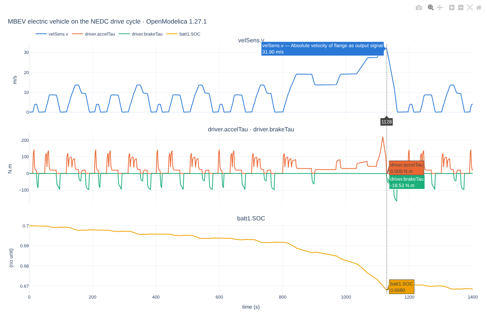
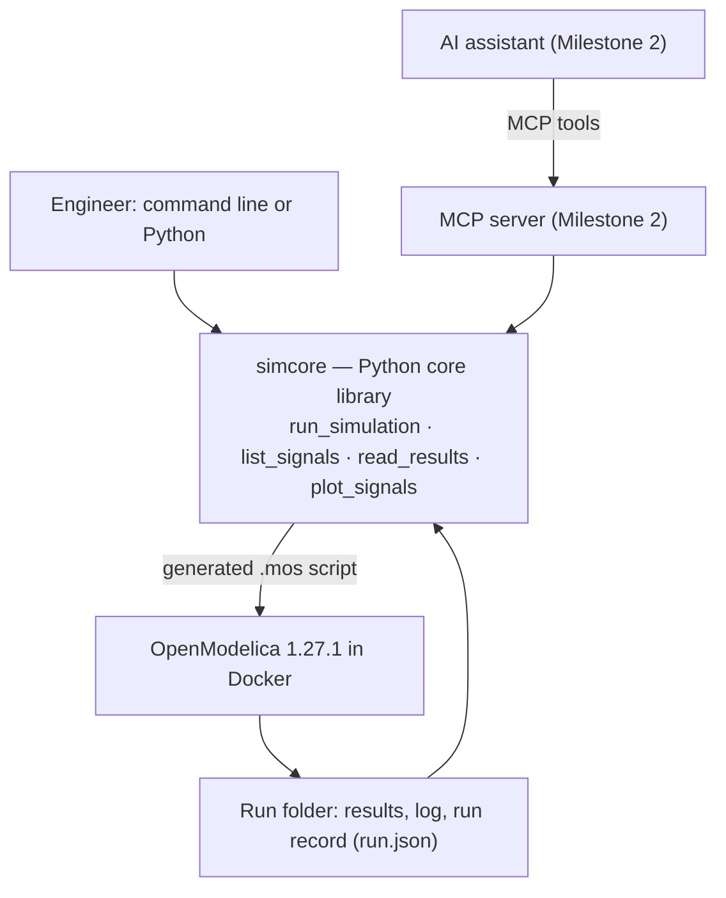

# modelica-agent

**Chat with your digital twin.**

An AI assistant that lets simulation engineers run and analyse Modelica models in plain language. The first use case is an electric vehicle.

> *"Run the NEDC cycle for the EV model, then plot battery state of charge."*

The assistant runs the simulation in [OpenModelica](https://openmodelica.org/) (inside Docker), reads the results and plots them, so engineers spend less time on tool mechanics and more on engineering decisions.



*An EV model on the NEDC drive cycle, plotted by `simcore`. Hovering at any time shows one cursor through all panels with every value at that instant: here the hard stop from 116 km/h, where brake torque rises and regenerative braking lifts the battery state of charge.*

## Why

Virtual validation involves many repetitive steps: choose a model, set up a drive cycle, run the simulation, find the right signal among hundreds, plot and compare. This project explores how much of that loop an AI assistant can handle **reliably**, and **measures** how often it gets things right.

## Status

| Milestone | Scope | Status |
|---|---|---|
| 0 | Reproducible environment: Docker + pinned OpenModelica, smoke test with a physics check | ✅ Done |
| 1 | Core library `simcore`: run a drive cycle, read results, plot | ✅ Done |
| 2 | MCP server so an AI assistant can use `simcore`; evaluation set of 30–50 engineer requests with measured accuracy and documented failure modes | 🔜 Next |
| 3 | "Chat to validate": requirement files, automatic pass/fail checks, test reports | Planned |
| 4 | Fault injection (e.g. degraded battery) and AI diagnosis accuracy | Planned |
| 5 | Product write-up, demo video | Planned |

## Quick start

**Prerequisites:** [Docker Desktop](https://www.docker.com/products/docker-desktop/) and Git. Works natively on Apple Silicon and on x86.

```bash
git clone --recurse-submodules https://github.com/swap1406/modelica-agent.git
cd modelica-agent
docker compose build                       # once: OpenModelica 1.27.1 + Python tools
```

Run an EV model, explore its signals, and plot them:

```bash
docker compose run --rm om python3 -m simcore run EHPTexamples.EV.MBEV
docker compose run --rm om python3 -m simcore signals latest:MBEV --search batt
docker compose run --rm om python3 -m simcore read latest:MBEV velSens.v batt1.SOC
docker compose run --rm om python3 -m simcore plot latest:MBEV velSens.v driver.accelTau driver.brakeTau batt1.SOC
```

The `plot` command prints the path of an interactive HTML chart: zoom by dragging, hover for values, double-click to reset.

The same functions work from Python:

```python
from simcore import run_simulation, list_signals, read_results, plot_signals

run = run_simulation("EHPTexamples.EV.MBEV")
print(run.summary())
data = read_results(run, ["velSens.v", "batt1.SOC"])
plot_signals(run, ["velSens.v", "batt1.SOC"])
```

## How it works



- **Docker, version-pinned.** OpenModelica and every Python package are pinned, so a result can be reproduced on any machine.
- **One folder per run.** Every simulation gets `results/runs/<date-time>_<Model>/` with the exact script that ran (`run.mos`), the results, the log, signal descriptions and a run record (`run.json`: status, errors and warnings, duration, software versions). Nothing is ever overwritten.
- **Engine separate from interface.** `simcore` doesn't know which AI or user interface calls it, so the engine's reliability can be tested on its own, separately from the AI's.

## Project structure

```
src/simcore/      core library (run.py, results.py, plotting.py, config.py)
tests/            automated tests (pytest)
models/           own models (HelloEV smoke test)
third_party/      EV model libraries, pinned as Git submodules
docker/           Dockerfile for the simulation image
scripts/          manual OpenModelica scripts (.mos)
results/          simulation runs (not committed)
```

## Tests

```bash
docker compose run --rm om python3 -m pytest -v
```

12 tests cover running models, clean failure on errors, reading and searching signals, and chart creation. The HelloEV test includes a physics check: simulated top speed must approach the hand-calculated 121 km/h.

## Models and credits

- **EV models:** [EHPTlib](https://github.com/ceraolo/EHPTlib) (BSD-3) and [EHPTexamples](https://github.com/ceraolo/EHPTexamples) by Prof. Massimo Ceraolo, University of Pisa. They are referenced as pinned Git submodules, not copied.
- **Modelica Standard Library** 4.x, installed by OpenModelica's package manager.
- **HelloEV:** a minimal 1-D vehicle written for this project to verify the toolchain.

modelica-agent is an independent project. It is not affiliated with or endorsed by the Modelica Association or the Open Source Modelica Consortium.

## Ground rules

- Only open-source models and publicly available parameters.
- No API keys in the code; secrets live in a local `.env` file that is never committed.
