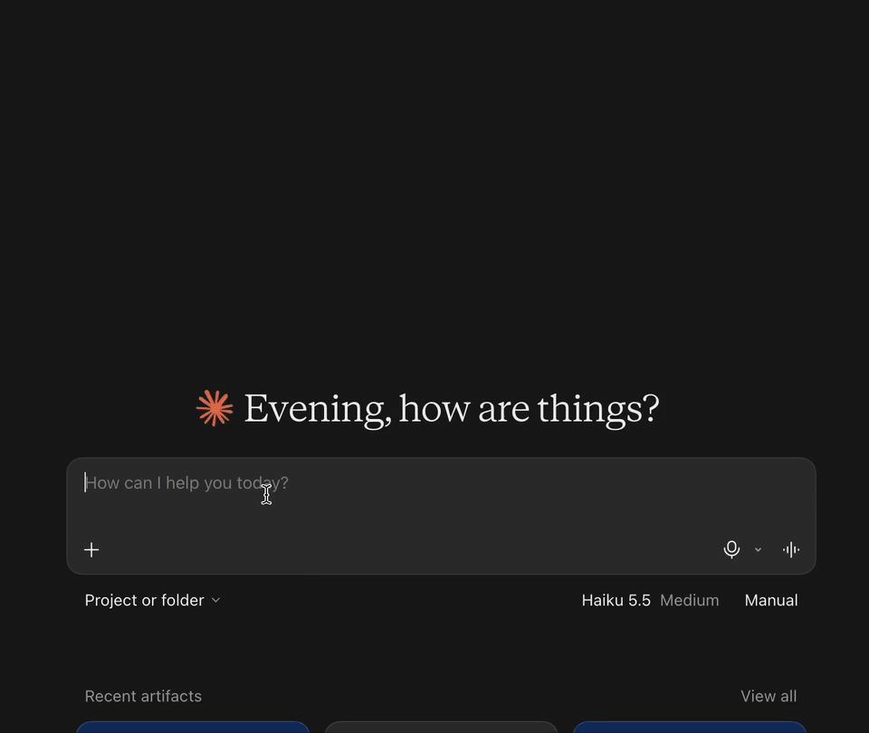
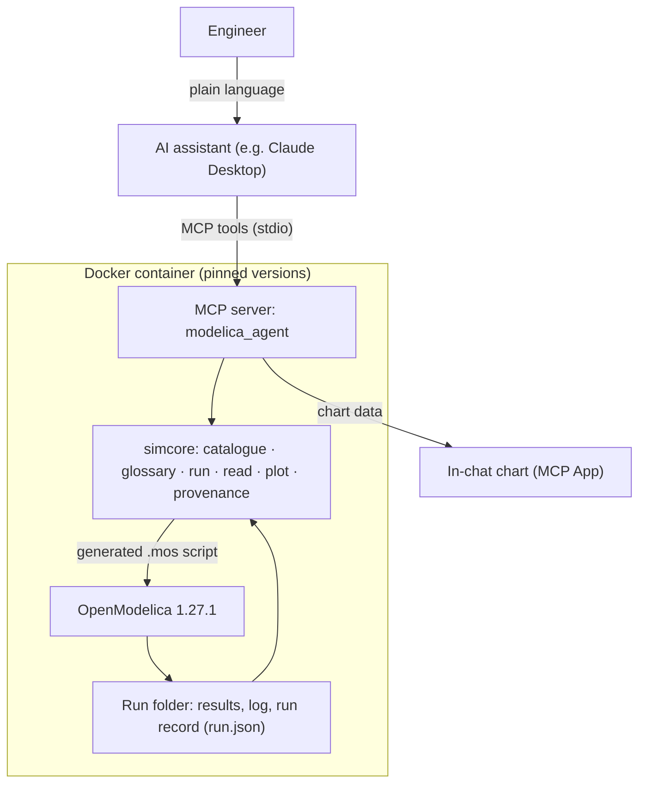

# modelica_agent

**Chat with your digital twin.**

An MCP server that lets AI assistants such as Claude run, analyse and plot [OpenModelica](https://openmodelica.org/) simulations in plain language, and a measured answer to the question *"how often does the AI get it right?"* The first use case is an electric vehicle on the NEDC drive cycle.

> **You:** *Run MBEV and tell me the energy consumption in Wh/km.*
>
> **Claude** *(calls `run_simulation`)*: MBEV completed one NEDC (1180 s, run `20261108-100846_MBEV`). The battery delivered 1.093 kWh net over 10.74 km: **≈ 101.7 Wh/km**. SOC fell from 70.0 % to 67.07 %. The start-up "structural singular" message is a known, harmless OpenModelica message; results are valid.
>
> **You:** *Why doesn't it reach the 120 km/h the cycle asks for?*
>
> **Claude** *(calls `read_results`, `plot_signals`)*: It's power-limited, not torque-limited: battery power sits at its 25 kW limit (≈ 22 kW at the motor shaft) from about 1099 s, so the car tops out at 116.6 km/h…



*One request in Claude Desktop: modelica_agent runs OpenModelica, the chart opens as an **interactive panel inside the chat** (MCP App: linked cursor across panels, zoom and pan), and Claude summarises the run. Waiting time sped up.*

## Results (v0.2.0)

Evaluated on **43 typical engineer requests** (finding models and signals, running, reading values, engineering reasoning, plotting, comparing runs, error handling, ambiguous requests), each scored against ground truth from real simulation data:

| Metric | Result |
|---|---|
| Requests answered correctly | **98.8 %** baseline → **100 %** after eval-driven fixes |
| Correct tool and correct signal chosen | 43 / 43 |
| Invented numbers (not backed by a tool result) | **0** |
| Guardrails respected (unknown model, oversized run, unsupported change) | 3 / 3 |
| Human spot-check in Claude Desktop | 7 / 8 |

The spot-check failure was the most useful finding: in a chat that also had file-editing tools, the assistant worked around "parameters can't be changed yet" by **editing the vendored model file**, and the run looked normal. That led to the [provenance check](#reliability-by-design): every run now records whether the model sources were the approved ones. Details: [`eval/`](eval/).

## Why

Virtual validation involves many repetitive steps: choose a model, set up a drive cycle, run the simulation, find the right signal among hundreds, plot and compare. This project explores how much of that loop an AI assistant can handle **reliably**, and **measures** it.

## Status

| Milestone | Scope | Status |
|---|---|---|
| 0 | Reproducible environment: Docker + pinned OpenModelica, smoke test with a physics check | ✅ Done |
| 1 | Core library `simcore`: run a drive cycle, read results, plot | ✅ v0.1.0 |
| 2 | MCP server for AI assistants, in-chat interactive charts, signal glossary, evaluation (43 requests) | ✅ v0.2.0 |
| 3 | "Chat to validate": requirement files, automatic pass/fail checks, test reports | 🔜 Next |
| 4 | Fault injection (e.g. degraded battery, wrong gear ratio) via parameter overrides; AI diagnosis accuracy | Planned |
| 5 | Product write-up, demo video | Planned |

## Quick start

**Prerequisites:** [Docker Desktop](https://www.docker.com/products/docker-desktop/) and Git. Works natively on Apple Silicon and on x86.

```bash
git clone --recurse-submodules https://github.com/swap1406/modelica_agent.git
cd modelica_agent
docker compose build                                  # once: OpenModelica 1.27.1 + Python tools
docker compose run --rm om python3 -m pytest -q       # optional: 47 tests
```

### Use it with Claude Desktop

1. In Claude Desktop, open **Settings → Developer → Edit Config** and add the `modelica_agent` entry from [`docs/claude_desktop_config.example.json`](docs/claude_desktop_config.example.json). Replace `/ABSOLUTE/PATH/TO/modelica_agent` with your clone's path, and check the Docker path with `which docker`.
2. Make sure Docker Desktop is running, then quit and reopen Claude Desktop.
3. Ask, for example: *"Which simulation models do you have?"*, *"Run MBEV and plot SOC and speed"*, *"What was the maximum motor torque?"*

Any MCP-capable assistant can use the server the same way: it starts `python3 -m simcore.mcp_server` inside the container and talks over stdio.

### Or use the library directly

```bash
docker compose run --rm om python3 -m simcore run EHPTexamples.EV.MBEV --stop-time 1180
docker compose run --rm om python3 -m simcore signals latest:MBEV --search batt
docker compose run --rm om python3 -m simcore plot latest:MBEV velSens.v batt1.SOC
```

```python
from simcore import run_model, summarize_signals, plot_signals

run, summary, _ = run_model("MBEV")                    # one NEDC, standard settings
print(summarize_signals(run, ["batt1.SOC", "velSens.v"]))
plot_signals(run, ["velSens.v", "batt1.SOC"])
```

## Tools the AI can use

| Tool | What it does |
|---|---|
| `list_models` | Models with what they represent (vehicle, drive cycle, standard run length), their signal glossary and latest run |
| `run_simulation` | Runs a catalogue model with standard settings; returns run id, errors, labelled harmless messages, warnings and a key-signal summary |
| `list_runs` | Recent runs, newest first, with status and whether the model sources were modified |
| `list_signals` | Finds signals by engineering term (e.g. "motor torque"); verified glossary matches first |
| `read_results` | Start / end / min / max (with times) or the value at a given time, in readable units (km/h, %, kWh, rpm…) |
| `plot_signals` | Interactive chart inside the chat (MCP App), plus an image the AI can read and an HTML file |
| `environment_info` | Software versions |

## How it works



- **Docker, version-pinned.** OpenModelica and every Python package are pinned, so results reproduce on any machine.
- **One folder per run.** The exact script, results, log, signal descriptions and a run record (status, errors, warnings, versions, provenance). Nothing is overwritten.
- **Engine separate from interface.** `simcore` works from the command line, Python or MCP, so the engine can be tested without an AI (47 tests) and the AI can be evaluated separately.

## Reliability by design

- **Model catalogue:** a short, reviewed card per model (vehicle, drive cycle, standard run length, quirks), because model files alone don't tell an AI which model to use.
- **Signal glossary:** one MBEV run has 267 signals, mostly internal. [`glossaries/`](glossaries/) maps engineering terms to the right signal, with sign conventions, checked against real data and approved by a domain expert. Example: *"motor torque"* is `eleDrive.tauElectrical` (limited to 150 N·m), not the driver's torque request (up to 220 N·m). Models without a glossary still work.
- **Readable units for any model:** m/s → km/h, rad/s → rpm, J → kWh, W → kW, K → °C.
- **Known harmless messages** are labelled, so neither the engineer nor the AI mistakes them for failures.
- **Guardrails:** catalogue models only, run length 0–20,000 s, no editing of model files.
- **Provenance:** every run compares the model sources with approved fingerprints (`models/source_manifest.json`). A run made from modified files is flagged `model_modified` everywhere it appears.
- **Small, traceable answers:** tools return summaries with the run id, never raw time series, so every number in an answer can be traced to a run.

## Evaluation

[`eval/requests.json`](eval/requests.json) holds 43 requests in 8 categories, each with the expected answer from real data, a pass rule with tolerances and the expected tools. [`eval/README.md`](eval/README.md) describes the method and scoring; [`eval/results/`](eval/results/) has the per-request results, the fixes and the spot-check. Re-run it after every change to tools, glossary or instructions.

## Related work

- **OMEdit's built-in MCP server** (OpenModelica, experimental): drives the graphical editor (diagram editing, parameters, simulation). modelica_agent is headless and Docker-based instead, so it also suits macOS and automation.
- **[Casys-AI/mcp-modelica](https://github.com/Casys-AI/mcp-modelica)**: safety-first, approved simulation kits and MCP App viewers; its viewer approach informed the in-chat chart here.
- **[Orthogonal modelica_simulation_mcp_server](https://github.com/Orthogonalpub/modelica_simulation_mcp_server)**: simulation through a cloud IDE.

What modelica_agent focuses on: a **published evaluation** with documented failure modes, verified domain content (catalogue, glossary), provenance, and the validation workflow planned next (requirements, pass/fail checks, fault diagnosis).

## Project structure

```
src/simcore/        core library and MCP server (mcp_server.py; ui/ holds the in-chat chart)
glossaries/         signal glossaries, one JSON file per model
eval/               evaluation set, method and results
models/             own models (HelloEV) and the approved model-source manifest
third_party/        EV model libraries, pinned as Git submodules
tests/              automated tests (pytest)
docker/             Dockerfile for the simulation image
docs/               images, example Claude Desktop config
results/            simulation runs (not committed)
```

## Models and credits

- **EV models:** [EHPTlib](https://github.com/ceraolo/EHPTlib) (BSD-3) and [EHPTexamples](https://github.com/ceraolo/EHPTexamples) by Prof. Massimo Ceraolo, University of Pisa, referenced as pinned Git submodules, not copied.
- **Modelica Standard Library** 4.x, installed by OpenModelica's package manager.
- **HelloEV:** a minimal 1-D vehicle written for this project to verify the toolchain.
- **In-chat chart:** [uPlot](https://github.com/leeoniya/uPlot) and the MCP Apps client ([ext-apps](https://github.com/modelcontextprotocol/ext-apps)).

modelica_agent is an independent project. It is not affiliated with or endorsed by the Modelica Association or the Open Source Modelica Consortium.

## Ground rules

- Only open-source models and publicly available parameters.
- No API keys in the code; secrets live in a local `.env` file that is never committed.
